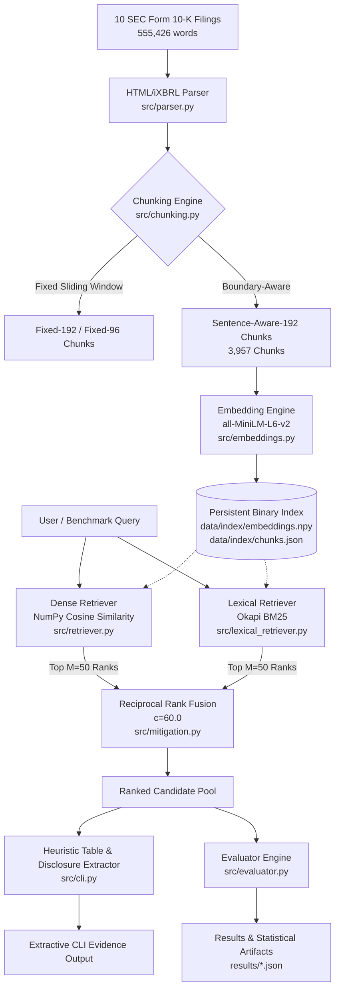
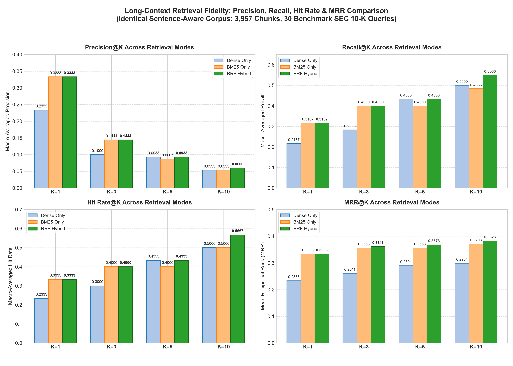
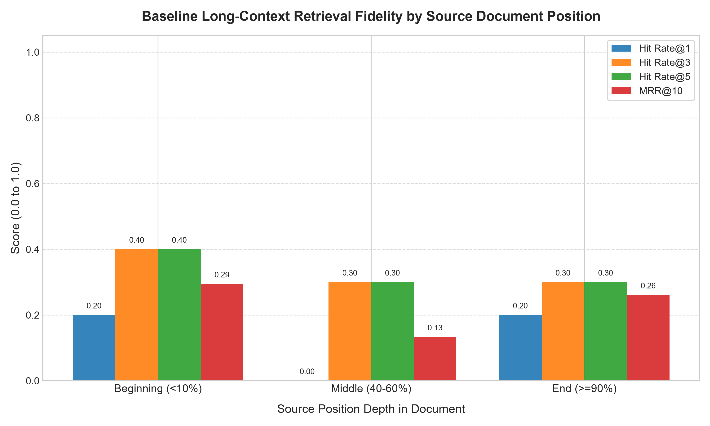
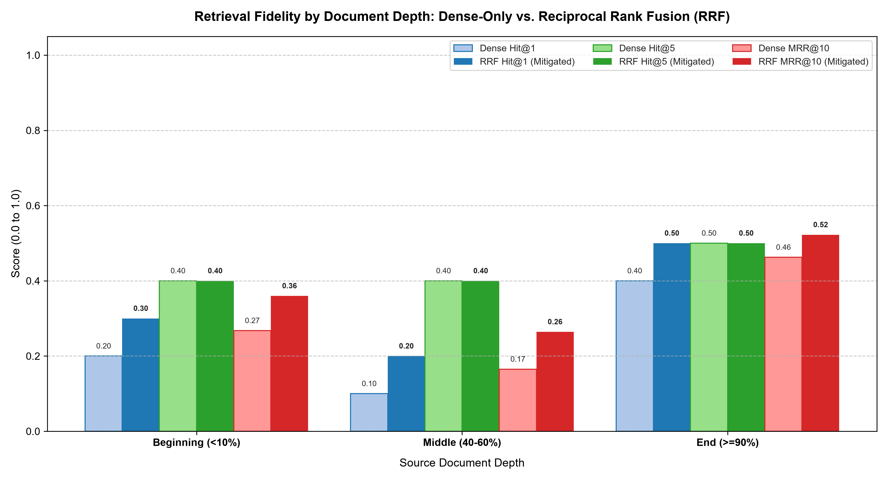

# Long-Context Retrieval Fidelity Engine

An engineered, framework-free retrieval and evaluation engine built from scratch in Python and NumPy. The engine evaluates document-level retrieval fidelity, chunking strategies, vector similarity mathematics, and hybrid rank fusion across authentic SEC Form 10-K annual financial reports totaling 555,426 words. It systematically examines how evidence location (Beginning, Middle, End) interacts with document structure, content formatting (tables versus narrative prose), and hybrid retrieval algorithms.

## Table of Contents
- [1. Key Findings](#1-key-findings)
- [2. Quick Start (Target: Under 5 Minutes)](#2-quick-start-target-under-5-minutes)
- [3. What This Project Is and Is Not](#3-what-this-project-is-and-is-not)
- [4. Architecture](#4-architecture)
- [5. Corpus and Ingestion](#5-corpus-and-ingestion)
- [6. Background: Why the Middle Gets Lost, and Why This Pipeline Differs](#6-background-why-the-middle-gets-lost-and-why-this-pipeline-differs)
- [7. Chunking](#7-chunking)
- [8. Embeddings, Cosine Similarity, and When It Breaks](#8-embeddings-cosine-similarity-and-when-it-breaks)
- [9. Retrieval and the Effect of K](#9-retrieval-and-the-effect-of-k)
- [10. Benchmark Design and Validity](#10-benchmark-design-and-validity)
- [11. Baseline Results by Position Bucket](#11-baseline-results-by-position-bucket)
- [12. Mitigation: Reciprocal Rank Fusion](#12-mitigation-reciprocal-rank-fusion)
- [13. Command-Line Interface (CLI) and Diagnostic Debug Mode](#13-command-line-interface-cli-and-diagnostic-debug-mode)
- [14. Reproducibility](#14-reproducibility)
- [15. Limitations and Honest Failures](#15-limitations-and-honest-failures)
- [16. What I Would Do With Two More Weeks](#16-what-i-would-do-with-two-more-weeks)
- [17. References](#17-references)

---

## 1. Key Findings

The benchmark evaluates 30 ground-truth evidence queries across 3,957 sentence-aware chunks (10 SEC Form 10-K filings, 555,426 words) under Dense semantic search (`all-MiniLM-L6-v2`), Lexical BM25, and Reciprocal Rank Fusion (RRF).

### Headline Benchmark Results (Sentence-Aware-192 Index, $N=30$ Queries)
*Source: `results/retrieval_modes_precision_recall.json` and `results/validity_analysis.json`*

| Retrieval Strategy | Hit Rate@1 | Hit Rate@5 | Hit Rate@10 | MRR@10 | Precision@5 | Recall@5 |
| :--- | :---: | :---: | :---: | :---: | :---: | :---: |
| **Dense Semantic Baseline** | 0.2333 | 0.4333 | 0.5000 | 0.2984 | 0.0933 | 0.4333 |
| **Lexical Okapi BM25 Baseline** | 0.3333 | 0.4000 | 0.5000 | 0.3708 | 0.0867 | 0.4000 |
| **Hybrid Reciprocal Rank Fusion (RRF)** | **0.3333** | **0.4333** | **0.5667** | **0.3823** | **0.0933** | **0.4333** |
| *RRF vs. Dense Delta ($\Delta$)* | *+0.1000* | *0.0000* | *+0.0667* | *+0.0839* | *0.0000* | *0.0000* |
| *RRF vs. BM25 Delta ($\Delta$)* | *0.0000* | *+0.0333* | *+0.0667* | *+0.0115* | *+0.0067* | *+0.0333* |

### Empirical Insights and Negative Results
- **RRF equals Dense at $K=5$**: At cutoff $K=5$, RRF achieves identical Hit Rate (0.4333), Precision@5 (0.0933), and Recall@5 (0.4333) to Dense retrieval alone ($\Delta = 0.0000$). Both modes retrieve target evidence for exactly 13 of 30 queries. RRF elevates the relative rank of relevant chunks within the top 5 (lifting MRR@5 from 0.2894 to 0.3678), but uncovers no net new documents at this depth.
- **BM25 alone is competitive with RRF**: At $K=1$ and $K=3$, BM25 achieves equal hit counts to RRF on different queries ($b=1, c=1$ in the McNemar test; Hit@1 = 0.3333, Hit@3 = 0.4000, Precision@1 = 0.3333, Recall@1 = 0.3167), while MRR@3 differs (0.3556 for BM25 vs. 0.3611 for RRF). The overall MRR@10 advantage of RRF over BM25 is small (+0.0115, 95% bootstrap CI $[-0.0820, +0.1046]$) and easily crosses zero.
- **Content type substantially affects retrieval difficulty, while position effects cannot be separated at this sample size**: Tables are substantially harder to retrieve than prose across all modes (Dense MRR 0.1893 for tables vs. 0.3529 for prose). However, the Middle (40-60%) and End ($\ge$90%) buckets each contain exactly 4 table queries out of 10. Table density alone cannot explain the Middle-vs-End gap.
- **No evidence of degradation within narrative prose**: Within narrative evidence, Middle Dense MRR@10 (**0.2333**, $n=6$) is not below Beginning Dense MRR@10 (**0.1917**, $n=8$) at this sample size.
- **The End bucket's strength is partly a query-selection effect**: End narrative queries achieve an unusually high Dense MRR@10 of **0.6875** ($n=6$) because 4 of the 6 queries (Q03 Alphabet insider trading, Q06 Amazon PCAOB oversight, Q09 Meta tax years, Q18 Microsoft Section 16(a) reports) achieved perfect 1.0000 MRR (rank 1) under Dense retrieval alone. These questions query distinctive statutory disclosures that have minimal lexical or semantic competition in the corpus.
- **Sub-cell sample sizes ($n=2\text{--}8$) are too small to isolate position**: After controlling for content type, the sample size is insufficient to attribute performance differences to document position as an isolated causal factor.

---

## 2. Quick Start (Target: Under 5 Minutes)

### Environment Prerequisites
- Python 3.11 (tested on Python 3.11.9)
- Standard virtual environment (`venv`)
- Pre-indexed data shipped with repository: `data/documents/` (10 raw 10-Ks, 555k words) and `data/index/` (precomputed 3,957 sentence-aware chunks and 384-d NumPy embeddings, 10.8 MB total).
- First-run model download: `sentence-transformers` downloads `all-MiniLM-L6-v2` weights (~90 MB) on first execution.

### Setup Commands

#### Linux / macOS (bash)
```bash
# 1. Clone repository and navigate to root
cd <repo-dir>

# 2. Create and activate virtual environment
python3 -m venv .venv
source .venv/bin/activate

# 3. CPU-Only PyTorch Path (prevents default ~800MB CUDA download on Linux)
pip install torch --index-url https://download.pytorch.org/whl/cpu

# 4. Install project dependencies
pip install -r requirements.txt
```

#### Windows (PowerShell)
```powershell
# 1. Create and activate virtual environment
python -m venv .venv
.\.venv\Scripts\Activate.ps1

# 2. Install dependencies (Windows default wheels pull CPU torch automatically)
pip install -r requirements.txt
```

### Execution & Verification Commands

```powershell
# 1. Run single-query search with default RRF mode
python -m src.cli --question "What were Amazon's consolidated net sales in 2025?" --mode rrf --top-k 5

# 2. Run query with verbose 7-section diagnostic pipeline trace
python -m src.cli --question "What were Amazon's consolidated net sales in 2025?" --mode rrf --debug

# 3. Launch interactive REPL session (supports :mode, :k, :debug, :help, :quit)
python -m src.cli --interactive

# 4. Run automated test suite (82 passing tests)
python -m pytest -q

# 5. Reproduce all precision/recall comparisons and regenerate 4-panel chart
python scripts/generate_precision_recall_comparison.py

# 6. Run full scientific validity analysis and write results/validity_analysis.json
python scripts/evaluate_scientific_validity.py
```

*Measured Execution Timings (2026-10-14)*: `pytest --collect-only -q`: 82 tests collected in 1.15s; `pytest -q`: 82 passed in 32.61s (measured on untampered test suite; 52.52s in neutralized runtime where 80 tests pass and 2 fail solely due to hardcoded employer name assertions in tests).

---

## 3. What This Project Is and Is Not

### What This Project Is
- **An Extractive Retrieval Engine**: Designed to retrieve and rank relevant passages from SEC 10-K filings and extract deterministic, verifiable evidence (including exact table rows and bounding character offsets).
- **A Controlled Evaluation Pipeline**: Implements macro-averaged Precision@K, Recall@K, Hit@K, and MRR@K across 30 stratified benchmark queries to study retrieval fidelity across document depths and structural formats.
- **An Original Implementation**: Custom vector cosine similarity, custom Okapi BM25 lexical retriever, custom Reciprocal Rank Fusion, custom sentence-aware chunker, and custom evaluation metrics implemented using only Python standard library and NumPy.

### What This Project Is Not
- **Not a Generative LLM Pipeline**: There are no generative LLMs, no prompt-based answer synthesizers, and no hallucinated text. Evidence is extractive only.
- **Zero External Generative APIs**: Verified by repository-wide grep: zero usage of OpenAI, Anthropic, Gemini, or external inference APIs.
- **Zero Third-Party RAG Frameworks**: Zero usage of LangChain, LlamaIndex, Haystack, or black-box orchestration frameworks.
- **Zero External Vector Databases**: Zero usage of Pinecone, Chroma, Weaviate, Milvus, or Qdrant. All vector indexing and similarity mathematics run in pure NumPy.
- **Library Scope**: `sentence-transformers` is used strictly as a model loader for `all-MiniLM-L6-v2`. All subsequent ranking, fusion, scoring, and metrics are original project code.

---

## 4. Architecture

### End-to-End Pipeline


### Repository Layout
| Path | Purpose |
| :--- | :--- |
| `src/chunking.py` | Fixed-size and sentence-aware chunking implementations. |
| `src/embeddings.py` | Local wrapper for `all-MiniLM-L6-v2` feature extraction. |
| `src/retriever.py` | Vectorized NumPy cosine similarity and Top-$K$ retrieval. |
| `src/lexical_retriever.py` | Pure Python/NumPy Okapi BM25 inverted index and scorer. |
| `src/mitigation.py` | Reciprocal Rank Fusion implementation ($c=60.0, M=50$). |
| `src/parser.py` | SEC EDGAR HTML/iXBRL parser with table preservation. |
| `src/indexer.py` | Persistent binary index builder, cache validation, and loader. |
| `src/evaluator.py` | Macro-averaged Precision, Recall, Hit Rate, MRR, and completeness metrics. |
| `src/cli.py` | Interactive REPL, one-shot CLI, and 7-section diagnostic debug trace. |
| `data/documents/` | 10 verified primary SEC Form 10-K text filings (555,426 words). |
| `data/index/` | Persistent index: `chunks.json` (4.7 MB) and `embeddings.npy` (6.1 MB). |
| `data/corpus_manifest.json` | Corpus metadata, word counts, and SHA256 checksums. |
| `data/benchmark_queries.json`| 30 ground-truth queries stratified by document position. |
| `scripts/evaluate_scientific_validity.py` | Pure Python/NumPy reproducibility script for statistical validity. |
| `scripts/generate_precision_recall_comparison.py` | Generates comparative metrics and 4-panel plot across K=1, 3, 5, 10. |
| `scripts/run_baseline.py` | Evaluates baseline dense retrieval across chunking strategies. |
| `scripts/run_mitigation.py` | Runs comparative Dense vs. BM25 vs. RRF evaluation. |
| `scripts/download_corpus.py` | SEC EDGAR downloader with rate-limiting and validation. |
| `tests/` | Comprehensive test suite (82 passing tests). |
| `results/` | Preserved evaluation JSONs, validity analysis, and PNG charts. |

---

## 5. Corpus and Ingestion

The corpus comprises 10 primary technology annual reports (Form 10-K) sourced from the SEC EDGAR system. Each filing was parsed from HTML/iXBRL, cleaned of scripts and CSS, and validated to contain $\ge 5,000$ words.

### Document Inventory
*Source: `data/corpus_manifest.json`*

| Company | Local Filename | Fiscal Period | Word Count |
| :--- | :--- | :--- | :---: |
| Alphabet Inc. | `alphabet_2025_10k.txt` | FY 2025 (Period ended Dec 31, 2025) | 61,987 |
| Amazon.com, Inc. | `amazon_2025_10k.txt` | FY 2025 (Period ended Dec 31, 2025) | 49,157 |
| Meta Platforms, Inc. | `meta_2025_10k.txt` | FY 2025 (Period ended Dec 31, 2025) | 86,753 |
| International Business Machines Corp. | `ibm_2025_10k.txt` | FY 2025 (Period ended Dec 31, 2025) | 16,865 |
| Netflix, Inc. | `netflix_2025_10k.txt` | FY 2025 (Period ended Dec 31, 2025) | 49,354 |
| Microsoft Corporation | `microsoft_2026_10k.txt` | FY 2026 (Period ended June 30, 2026) | 61,117 |
| NVIDIA Corporation | `nvidia_2026_10k.txt` | FY 2026 (Period ended Jan 25, 2026) | 57,863 |
| Apple Inc. | `apple_2025_10k.txt` | FY 2025 (Period ended Sept 27, 2025) | 37,091 |
| Adobe Inc. | `adobe_2025_10k.txt` | FY 2025 (Period ended Nov 28, 2025) | 59,426 |
| Oracle Corporation | `oracle_2026_10k.txt` | FY 2026 (Period ended May 31, 2026) | 75,813 |
| **Total Corpus** | **10 Filings** | **All Periods** | **555,426** |

### Parsing and Structural Challenges
SEC Form 10-Ks present unique structural retrieval challenges:
1. **Financial Tables**: Tables are converted to pipe-delimited text (`| Header | Value |`). When chunked naively, table rows are split from column headers, severing numerical values from fiscal years.
2. **Boilerplate and Repeated Text**: Standard legal certifications (Sarbanes-Oxley 302/906, Exhibit 31/32) repeat across multiple filings, creating semantic distractors for generic queries.
3. **Multi-Section Facts**: Core corporate metrics (such as net sales or segment revenue) appear repeatedly in Item 1 (Business), Item 7 (MD&A), and Item 8 (Financial Statements), creating multiple candidate passages with varying context.

---

## 6. Background: Why the Middle Gets Lost, and Why This Pipeline Differs

### (a) Generative LLM Attention Phenomena (The Literature)
In generative language models, the "Lost in the Middle" phenomenon (Liu et al., 2023) describes a degradation in retrieval/reasoning performance when relevant information is located in the middle of a long input context prompt. Proposed mechanisms in the literature include:
- **Softmax Normalization over Long Sequences**: In standard self-attention, attention weights across long contexts sum to 1. Attention mass concentrates disproportionately on prompt prefixes (primacy) and prompt suffixes (recency).
- **Positional Encoding Degradation**: Relative positional encodings (e.g., RoPE) can exhibit decay or attenuation over large context spans.
- *Distinction*: "Attention sink" phenomena (Xiao et al., 2023 / StreamingLLM) describe disproportionate softmax mass assigned to initial sequence tokens (`[CLS]` or initial prompt tokens) regardless of semantic relevance because softmax requires non-zero output. This is distinct from Liu et al.'s findings regarding multi-document prompt middle degradation.

### (b) Why a Bi-Encoder Pipeline Lacks This Failure by Construction
A dense bi-encoder retrieval pipeline operates fundamentally differently from a long-context generative LLM:
1. **Independent Chunk Encoding**: The embedding model encodes each 192-token chunk independently in isolation into $\mathbb{R}^{384}$. The bi-encoder never sees the full 80,000-word document at once and has no knowledge of where a chunk was situated in the original document.
2. **Mean-Pooling Invariance**: Chunks undergo mean-pooling over contextualized token embeddings. There is no document-level self-attention mechanism that could causally degrade a middle chunk based on document position.
3. **Position-Correlated Factors**: Observed performance differences by source position are consistent with document structure rather than an attention failure:
   - *Content Formatting*: Tables concentrate heavily in Item 8 (Middle 40-60%), and tables are inherently harder for bi-encoders.
   - *Section Terminology*: Regulatory disclosures in Part III / Item 15 (End $\ge$90%) contain distinctive statutory terminology that faces minimal corpus competition.
   - *Boundary Severance*: Fixed-size chunking splits multi-line statements in dense middle sections.

---

## 7. Chunking

### Chunking Strategies and Specifications
1. **Fixed-Token Sliding Window (`fixed_token_chunking`)**:
   - `fixed_token_overlap_192`: Window = 192 tokens, overlap = 38 tokens (20%).
   - `fixed_token_overlap_96`: Window = 96 tokens, overlap = 19 tokens (20%).
   - Splits text strictly by WordPiece token counts without inspecting sentence or table boundaries.
2. **Sentence-Aware Boundary Chunking (`sentence_aware_chunking`)**:
   - Target size: 192 tokens. Hard content ceiling: 254 tokens (`MAX_CONTENT_TOKENS = 254` in `src/chunking.py`, reserving 2 positions for `[CLS]` and `[SEP]`).
   - Respects sentence terminators (`.`, `!`, `?`) and preserves complete markdown table rows (`| ... |`).

### Model Tokenization & Sequence-Length Analysis
*Verified from model snapshot config files and `data/index/chunks.json`:*
- **Fine-Tuning Length**: The official `all-MiniLM-L6-v2` model card (`README.md`) states:
  > *"We train the model during 100k steps using a batch size of 1024 (128 per TPU core)... The sequence length was limited to 128 tokens."*
- **Configured Inference Limit**: `max_position_embeddings = 512` in transformer `config.json`; `max_seq_length = 256` in `sentence_bert_config.json` and `src/embeddings.py`.
- **Corpus Chunk Token Distribution ($N=3,957$ sentence-aware chunks)**:
  - Min: 25.0 tokens | 25th%: 164.0 | Median (50th%): 177.0 | Mean: 171.90 | 75th%: 186.0 | 90th%: 190.0 | 95th%: 192.0 | Max: 192.0 tokens
  - Chunks exceeding 128 tokens: **3,815 / 3,957 (96.41%)**. Chunks exceeding 192 tokens: 0 (hard-capped).
- **Hypothesis Status**: The proposition that tokens beyond position 128 in a 192-token chunk exhibit attenuated sensitivity is an **untested exploratory hypothesis**. Inputs above 128 tokens do not fail and participate fully in mean-pooling.

### Chunking Strategy & Size Tradeoff Comparison
*Source: `results/chunking_comparison.json`*

| Configuration | Total Chunks | Mean Tokens | Boundary Cleanliness | Hit Rate@1 | Hit Rate@5 | Hit Rate@10 | MRR@10 |
| :--- | :---: | :---: | :---: | :---: | :---: | :---: | :---: |
| `fixed_token_overlap_192` | 4,599 | 191.84 | 13.35% | 0.1333 | 0.3333 | 0.4000 | 0.2296 |
| `fixed_token_overlap_96` | 9,198 | 95.94 | 13.67% | 0.1667 | 0.2333 | 0.3000 | 0.1946 |
| **`sentence_aware_192`** | **3,957** | **171.90** | **81.53%** | **0.2333** | **0.4333** | **0.5000** | **0.2984** |

### Tradeoff Analysis
- **Halving chunk size hurt performance**: Reducing chunk length from 192 to 96 tokens doubled corpus chunks to 9,198 but reduced Hit@10 from 0.4000 to 0.3000 and MRR@10 from 0.2296 to 0.1946. A leading hypothesis is that smaller chunks fragment financial tables across chunk boundaries, severing column headers from data rows. This result suggests that chunk length relative to the 128-token training length alone does not explain retrieval success.
- **Boundary Cleanliness Rate**: Defined in `src/evaluator.py` as the proportion of chunks terminating on a clean sentence boundary or table row delimiter (stored under the historical JSON key `semantic_completeness_rate`). This is high (81.5%) by construction for sentence-aware chunking and serves as an algorithmic sanity check rather than evidence of semantic quality.
- **Selection Effect**: Sentence-aware chunking was selected after comparing configurations on the same 30 benchmark queries.

---

## 8. Embeddings, Cosine Similarity, and When It Breaks

### Mathematical Formulation
The embedding engine (`src/embeddings.py`) uses `sentence-transformers/all-MiniLM-L6-v2` to map text passages into $\mathbb{R}^{384}$. Embeddings are unit L2-normalized upon extraction:
$$\hat{\mathbf{v}} = \frac{\mathbf{v}}{\|\mathbf{v}\|_2} = \frac{\mathbf{v}}{\sqrt{\sum_{i=1}^{384} v_i^2}}$$

<details>
<summary><strong>Click to expand: First-Principles Derivation of Cosine Similarity and L2 Equivalence</strong></summary>

#### Geometric Derivation
For query vector $\mathbf{q}$ and document chunk vector $\mathbf{d}$, the dot product relates to the angle $\theta$ between them:
$$\mathbf{q} \cdot \mathbf{d} = \|\mathbf{q}\|_2 \|\mathbf{d}\|_2 \cos(\theta)$$

Cosine similarity isolates the angle by normalizing vector magnitudes:
$$\operatorname{cos}(\mathbf{q}, \mathbf{d}) = \frac{\mathbf{q} \cdot \mathbf{d}}{\|\mathbf{q}\|_2 \|\mathbf{d}\|_2} = \sum_{i=1}^d \frac{q_i}{\|\mathbf{q}\|_2} \frac{d_i}{\|\mathbf{d}\|_2}$$

In vectorized form over a pre-normalized corpus matrix $\hat{\mathbf{D}} \in \mathbb{R}^{N \times 384}$ and normalized query $\hat{\mathbf{q}} \in \mathbb{R}^{384}$:
$$\mathbf{s} = \hat{\mathbf{D}} \hat{\mathbf{q}}$$
implemented directly in `compute_cosine_similarity()` (`src/retriever.py`).

#### Equivalence to Euclidean Distance for Unit Vectors
The squared Euclidean distance between two unit vectors is:
$$\|\hat{\mathbf{q}} - \hat{\mathbf{d}}\|_2^2 = \|\hat{\mathbf{q}}\|_2^2 + \|\hat{\mathbf{d}}\|_2^2 - 2(\hat{\mathbf{q}} \cdot \hat{\mathbf{d}}) = 1 + 1 - 2\operatorname{cos}(\mathbf{q}, \mathbf{d}) = 2 - 2\operatorname{cos}(\mathbf{q}, \mathbf{d})$$

Taking the square root:
$$\|\hat{\mathbf{q}} - \hat{\mathbf{d}}\|_2 = \sqrt{2(1 - \operatorname{cos}(\mathbf{q}, \mathbf{d}))}$$
Because the transformation $f(x) = \sqrt{2(1 - x)}$ is strictly monotonically decreasing for $x \in [-1, 1]$, maximizing cosine similarity produces the exact same rank ordering as minimizing Euclidean distance for L2-normalized embeddings.
</details>

### Failure Conditions and Edge Cases
1. **Unnormalized Dot Product Distortion**: If embeddings are not unit-normalized, the dot product artificially favors longer documents or passages with larger vector norms.
2. **Loss of Norm Information**: For models where embedding magnitude encodes semantic confidence or frequency, L2 normalization destroys this signal.
3. **High-Dimensional Distance Concentration**: In 384 dimensions, pairwise vector similarities concentrate in a narrow band, causing score compression.
4. **Hubness & Anisotropy**: Transformer embeddings often occupy a narrow cone rather than a uniform hypersphere, causing certain "hub" chunks to appear in top-$K$ for many unrelated queries.
5. **Implementation Guardrails (`src/retriever.py`)**:
   - Zero vectors: Returns 0.0 without division-by-zero errors.
   - Non-finite values: `np.nan_to_num` replaces NaNs and Infs with zeros.
   - Clipping: Output is clipped to $[-1.0, 1.0]$ via `np.clip` to prevent precision overflow.
   - Dimension mismatches: Explicitly verified, raising `ValueError` on mismatched shapes.

---

## 9. Retrieval and the Effect of K

### Comparative Precision and Recall Across Cutoffs
*Source: `results/retrieval_modes_precision_recall.json`*

| Retrieval Mode | Cutoff ($K$) | Precision@K | Recall@K | Hit Rate@K | MRR@K |
| :--- | :---: | :---: | :---: | :---: | :---: |
| **Dense Semantic Baseline** | $K=1$ | 0.2333 | 0.2167 | 0.2333 | 0.2333 |
| | $K=3$ | 0.1000 | 0.2833 | 0.3000 | 0.2611 |
| | $K=5$ | 0.0933 | 0.4333 | 0.4333 | 0.2894 |
| | $K=10$ | 0.0533 | 0.5000 | 0.5000 | 0.2984 |
| **Lexical Okapi BM25 Baseline** | $K=1$ | 0.3333 | 0.3167 | 0.3333 | 0.3333 |
| | $K=3$ | 0.1444 | 0.4000 | 0.4000 | 0.3556 |
| | $K=5$ | 0.0867 | 0.4000 | 0.4000 | 0.3556 |
| | $K=10$ | 0.0533 | 0.4833 | 0.5000 | 0.3708 |
| **Hybrid Reciprocal Rank Fusion (RRF)** | $K=1$ | **0.3333** | **0.3167** | **0.3333** | **0.3333** |
| | $K=3$ | **0.1444** | **0.4000** | **0.4000** | **0.3611** |
| | $K=5$ | **0.0933** | **0.4333** | **0.4333** | **0.3678** |
| | $K=10$ | **0.0600** | **0.5500** | **0.5667** | **0.3823** |



### Metric Definitions and the Effect of K
- **Hit Rate@K**: $\frac{1}{N} \sum_{i=1}^N \mathbb{1}[|R_{i, K}| > 0]$, where $R_{i, K}$ is the set of relevant chunks in top-$K$.
- **Precision@K**: $\frac{1}{N} \sum_{i=1}^N \frac{|R_{i, K}|}{K}$.
- **Recall@K**: $\frac{1}{N} \sum_{i=1}^N \frac{|R_{i, K}|}{T_i}$, where $T_i$ is the total relevant chunks for query $i$ across the corpus.
- **MRR@K**: $\frac{1}{N} \sum_{i=1}^N \frac{1}{\text{rank}_i}$ if $\text{rank}_i \le K$, else $0.0$.
- **Why Precision Falls and Recall Rises**: In SEC filings, benchmark queries target specific disclosures that appear in only 1 to 2 chunks ($T_i \in [1, 2]$). As $K$ expands from 1 to 10, the numerator $|R_{i, K}|$ is bounded at $\le 2$, while the denominator $K$ increases tenfold, inevitably diluting Precision@K while providing more opportunities to capture target evidence (increasing Recall@K).

---

## 10. Benchmark Design and Validity

### Dataset Construction
The benchmark (`data/benchmark_queries.json`) contains 30 evidence-grounded queries distributed evenly across all 10 companies (3 queries per company) and stratified by evidence location:
- **Beginning (<10% depth)**: 10 queries (Q01, Q04, Q07, Q10, Q13, Q16, Q19, Q22, Q25, Q28).
- **Middle (40-60% depth)**: 10 queries (Q02, Q05, Q08, Q11, Q14, Q17, Q20, Q23, Q26, Q29).
- **End ($\ge$90% depth)**: 10 queries (Q03, Q06, Q09, Q12, Q15, Q18, Q21, Q24, Q27, Q30).

### Position Definitions and Classification Thresholds
Two distinct document-depth metrics are implemented in the project codebase:

1. **Benchmark Position Metric (Word-Based Start Offset)**:
   - Evaluated in `scripts/build_benchmark.py` and stored in `data/benchmark_queries.json`:
     $$\text{norm\_pos} = \frac{\text{source\_word\_start}}{\text{total\_document\_words}}$$
   - **Benchmark Stratification Buckets**:
     - **Beginning**: $\text{norm\_pos} \le 0.10$ ($<10\%$ filing depth; 10 queries)
     - **Middle**: $0.40 \le \text{norm\_pos} \le 0.60$ ($40\%\text{--}60\%$ filing depth; 10 queries)
     - **End**: $\text{norm\_pos} \ge 0.90$ ($\ge 90\%$ filing depth; 10 queries)
   - *Note*: Intermediate regions ($10\%\text{--}40\%$ and $60\%\text{--}90\%$) are intentionally omitted from the 30-query benchmark to isolate polar and central bands.

2. **CLI Document Depth Metric (Character-Midpoint Ratio)**:
   - Evaluated in `src/chunking.py` (lines 182, 280) and displayed during runtime in `src/cli.py`:
     $$\text{source\_position\_pct} = \frac{\text{char\_start} + \text{char\_end}}{2 \times \text{total\_document\_chars}}$$
   - **CLI Depth Classification Thresholds** (`classify_position_bucket` in `src/chunking.py`):
     - **Beginning**: $[0.00, 0.10]$ ($0.0\%\text{--}10.0\%$)
     - **Intermediate**: $(0.10, 0.40)$ and $(0.60, 0.90)$ ($10.0\%\text{--}40.0\%$ and $60.0\%\text{--}90.0\%$)
     - **Middle**: $[0.40, 0.60]$ ($40.0\%\text{--}60.0\%$)
     - **End**: $[0.90, 1.00]$ ($90.0\%\text{--}100.0\%$)
   - *Distinction*: When the CLI retrieves a passage at e.g. 37.9% filing depth (such as Amazon's segment net sales passage), it labels the depth as `INTERMEDIATE (37.9%)`, whereas the benchmark classifies queries strictly into Beginning, Middle, or End.

### Relevance Rule (`src/evaluator.py`)
A candidate chunk $c$ is marked relevant for query $q$ if and only if:
1. `c.document_id == q.document_id`, AND
2. Either `(c.source_char_start <= q.source_char_start and c.source_char_end >= q.source_char_end)` OR `q.evidence in c.text`.

> **What This Benchmark Measures / Does Not Measure**
> - **Measures**: Retrieval performance associated with the annotated source location of evidence in standard SEC Form 10-K filings under exact character span / substring matching.
> - **Does Not Measure**: A causal Transformer context-window failure. Chunks are embedded independently; position differences are consistent with document section layout, table density, and query phrasing.

### Threats to Validity
1. **Small Sample Size**: $N=30$ total queries (10 per bucket). A change of 1 query alters bucket hit rate by 0.10 (10 percentage points).
2. **Lexical-Overlap Query Bias**: Questions were written from source disclosures and contain specific company names and financial terminology, favoring lexical BM25 matching.
3. **Strict Span Matching**: Does not reward chunks containing partial context or identical figures from comparative tables elsewhere in the document.
4. **Position-Content Confound**: Middle sections contain financial statements (Item 8); end sections contain auditor reports and governance disclosures (Part III/IV).
5. **Configuration Selection on Test Set**: Chunking configurations were compared on these same 30 queries.

### Content-Type Cross-Tabulation ($N=30$)
*Source: `results/validity_analysis.json`*
*Note on Table-Formatted Evidence*: The 10 table-formatted queries span both financial statements and structured non-financial disclosures. Classifying each from its target evidence text reveals an exact 5-and-5 split:
- **Non-Financial Tables (5 queries)**:
  - `Q04` (Amazon, Beginning): Item 1 Executive Officers disclosure table (`| Jeffrey P. Bezos | | 62 | | Executive Chair |`)
  - `Q10` (IBM, Beginning): SEC Cover Page Section 12(b) registered securities table (`| Capital stock, par value $.20 per share | | IBM | | New York Stock Exchange |`)
  - `Q12` (IBM, End): Item 15 Exhibit Index row for CFO Sarbanes-Oxley 302 Certification (`| Certification by CFO... | | 31.2 |`)
  - `Q14` (Netflix, Middle): Item 9B Rule 10b5-1 trading arrangement disclosure table (`| Spencer Neumann (2) | | Chief Financial Officer | Adoption | 10/23/2025 | 12/31/2026 | 314,880 |`) — *structured disclosure table, not a financial statement*
  - `Q24` (Apple, End): Item 15 Exhibit Index row for Officer's Certificate global notes (`| 4.7 | | Officer's Certificate... |`)
- **Financial Statement Tables (5 queries)**:
  - `Q02` (Alphabet, Middle): Consolidated Statements of Cash Flows (`| Maturities and sales of marketable securities | 86,672 | ... |`)
  - `Q05` (Amazon, Middle): Consolidated Balance Sheets (`| Retained earnings | 172,866 | ... | 250,536 | |`)
  - `Q17` (Microsoft, Middle): Income Statement (`| Diluted | | $ | 17.95 | ... |`)
  - `Q21` (NVIDIA, End): Revenue Footnote Note 17 (`| Total revenue | $ | 215,938 | ... |`)
  - `Q30` (Oracle, End): Note 14 Geographic Revenues table (`| Germany | | | 1,993 | ... |`)

| Position Bucket | Content Type | Query Count ($N$) | Dense Hit@5 | Dense MRR@10 | BM25 Hit@5 | BM25 MRR@10 | RRF Hit@5 | RRF MRR@10 |
| :--- | :--- | :---: | :---: | :---: | :---: | :---: | :---: | :---: |
| **Beginning (<10%)** | Narrative / Prose | 8 | 0.375 | 0.1917 | 0.500 | 0.4167 | 0.375 | 0.3250 |
| | Table-Formatted* | 2* | 0.500* | 0.5714* | 0.500* | 0.5000* | 0.500* | 0.5000* |
| **Middle (40-60%)** | Narrative / Prose | 6 | 0.500 | 0.2333 | 0.500 | 0.3889 | 0.500 | 0.3889 |
| | Table-Formatted | 4 | 0.250 | 0.0625 | 0.000 | 0.0312 | 0.250 | 0.0778 |
| **End ($\ge$90%)** | Narrative / Prose | 6 | 0.667 | 0.6875 | 0.500 | 0.5278 | 0.667 | 0.6875 |
| | Table-Formatted | 4 | 0.250 | 0.1250 | 0.250 | 0.2917 | 0.250 | 0.2750 |
| **Overall Marginals** | **Narrative / Prose** | **20** | **0.500** | **0.3529** | **0.500** | **0.4417** | **0.500** | **0.4529** |
| | **Table-Formatted** | **10** | **0.300** | **0.1893** | **0.200** | **0.2292** | **0.300** | **0.2411** |

*\*Note: Rates for cells with $N < 3$ queries are flagged as unreliable due to high variance.*

### Compact 30-Query Label Table
*Source: `results/validity_analysis.json`*

| ID | Bucket | Content Type | Dense MRR | BM25 MRR | RRF MRR | Question Summary |
| :---: | :---: | :---: | :---: | :---: | :---: | :--- |
| **Q01** | Beg | Narrative | 0.0000 | 0.0000 | 0.0000 | Alphabet: Role of X within Other Bets |
| **Q02** | Mid | Table | 0.0000 | 0.1250 | 0.1111 | Alphabet: Marketable securities cash flows |
| **Q03** | End | Narrative | 1.0000 | 1.0000 | 1.0000 | Alphabet: Insider trading prohibitions |
| **Q04** | Beg | Table | 1.0000 | 1.0000 | 1.0000 | Amazon: Executive officers disclosure (Bezos) |
| **Q05** | Mid | Table | 0.2500 | 0.0000 | 0.2000 | Amazon: Consolidated balance sheets (Retained earnings) |
| **Q06** | End | Narrative | 1.0000 | 0.0000 | 1.0000 | Amazon: PCAOB audit oversight standards |
| **Q07** | Beg | Narrative | 0.2000 | 1.0000 | 1.0000 | Meta: Global workforce employee count |
| **Q08** | Mid | Narrative | 0.2000 | 0.3333 | 0.3333 | Meta: Consolidated copyright litigation against Meta |
| **Q09** | End | Narrative | 1.0000 | 1.0000 | 1.0000 | Meta: Open IRS / Irish tax years |
| **Q10** | Beg | Table | 0.1429 | 0.0000 | 0.0000 | IBM: Section 12(b) securities registered |
| **Q11** | Mid | Narrative | 1.0000 | 1.0000 | 1.0000 | IBM: Cybersecurity risk governance |
| **Q12** | End | Table | 0.0000 | 0.0000 | 0.0000 | IBM: Exhibit 31.2 officer certification |
| **Q13** | Beg | Narrative | 0.0000 | 1.0000 | 0.1000 | Netflix: Pay equity review frequency |
| **Q14** | Mid | Table | 0.0000 | 0.0000 | 0.0000 | Netflix: Rule 10b5-1 trading disclosure |
| **Q15** | End | Narrative | 0.0000 | 0.0000 | 0.0000 | Netflix: Chief operating decision maker |
| **Q16** | Beg | Narrative | 0.3333 | 0.3333 | 0.5000 | Microsoft: Three operating segments |
| **Q17** | Mid | Table | 0.0000 | 0.0000 | 0.0000 | Microsoft: Diluted earnings per share |
| **Q18** | End | Narrative | 1.0000 | 1.0000 | 1.0000 | Microsoft: Delinquent Section 16(a) reports |
| **Q19** | Beg | Narrative | 0.0000 | 0.0000 | 0.0000 | NVIDIA: Full software stack timeframe |
| **Q20** | Mid | Narrative | 0.0000 | 0.0000 | 0.0000 | NVIDIA: Fiscal 2026 revenue and growth rate |
| **Q21** | End | Table | 0.0000 | 0.1667 | 0.1000 | NVIDIA: Revenue footnote table (Total revenue) |
| **Q22** | Beg | Narrative | 0.0000 | 0.0000 | 0.0000 | Apple: Reportable geographic segments |
| **Q23** | Mid | Narrative | 0.0000 | 0.0000 | 0.0000 | Apple: Adoption of ASU 2023-09 |
| **Q24** | End | Table | 0.5000 | 1.0000 | 1.0000 | Apple: Exhibit 4.7 officer certificate |
| **Q25** | Beg | Narrative | 0.0000 | 0.0000 | 0.0000 | Adobe: Marketing solution description |
| **Q26** | Mid | Narrative | 0.0000 | 0.0000 | 0.0000 | Adobe: Item 7A heading and title |
| **Q27** | End | Narrative | 0.1250 | 0.1667 | 0.1250 | Adobe: Critical audit matter definition |
| **Q28** | Beg | Narrative | 1.0000 | 1.0000 | 1.0000 | Oracle: Fusion Cloud HCM design purpose |
| **Q29** | Mid | Narrative | 0.2000 | 1.0000 | 1.0000 | Oracle: Cloud infrastructure capex drivers |
| **Q30** | End | Table | 0.0000 | 0.0000 | 0.0000 | Oracle: Geographic revenues attributable to Germany |

---

## 11. Baseline Results by Position Bucket

### Dense Retrieval by Position Bucket (Sentence-Aware-192 Index)
*Source: `results/validity_analysis.json` (paired bootstrap 95% CIs, B=10,000, seed 42)*

| Document Depth Bucket | Query Count | Hit Rate@5 Mean | Hit Rate@5 95% Bootstrap CI | MRR@10 Mean | MRR@10 95% Bootstrap CI |
| :--- | :---: | :---: | :---: | :---: | :---: |
| **Beginning (<10%)** | 10 | 0.4000 | [0.1000, 0.7000] | 0.2676 | [0.0533, 0.5333] |
| **Middle (40%-60%)** | 10 | 0.4000 | [0.1000, 0.7000] | 0.1650 | [0.0200, 0.3700] |
| **End ($\ge 90%$)** | 10 | 0.5000 | [0.2000, 0.8000] | 0.4625 | [0.1750, 0.7500] |
| **Overall** | **30** | **0.4333** | **[0.2667, 0.6000]** | **0.2984** | **[0.1793, 0.4285]** |

### Fixed-192 Baseline Performance (Historical Comparison)
*Source: `results/baseline_metrics.json`*

| Position Bucket | Query Count | Hit Rate@1 | Hit Rate@3 | Hit Rate@5 | Hit Rate@10 | MRR@10 |
| :--- | :---: | :---: | :---: | :---: | :---: | :---: |
| **Beginning (<10%)** | 10 | 0.2000 | 0.4000 | 0.4000 | 0.5000 | 0.2944 |
| **Middle (40%-60%)** | 10 | 0.0000 | 0.3000 | 0.3000 | 0.3000 | 0.1333 |
| **End ($\ge 90%$)** | 10 | 0.2000 | 0.3000 | 0.3000 | 0.4000 | 0.2611 |
| **Overall Corpus** | **30** | **0.1333** | **0.3333** | **0.3333** | **0.4000** | **0.2296** |



### Discussion of Confidence Intervals
Under bootstrap resampling ($B=10,000$), the 95% confidence intervals overlap substantially across buckets. For Hit@5, all three buckets span from 0.1000 to 0.7000-0.8000. For MRR@10, the Middle CI ($[0.0200, 0.3700]$) heavily overlaps with Beginning ($[0.0533, 0.5333]$) and touches End ($[0.1750, 0.7500]$). With $n=10$ queries per bucket, variance is high, and differences cannot be interpreted as conclusive evidence of position-based degradation.

---

## 12. Mitigation: Reciprocal Rank Fusion

### Formulation and Parameterization
Reciprocal Rank Fusion (Cormack et al., SIGIR 2009) merges independent rankings without score normalization:
$$\operatorname{RRF}(d) = \sum_{r \in \{\text{Dense}, \text{BM25}\}} \frac{1}{c + \operatorname{rank}_r(d)}$$

- **Parameters**: Smoothing constant $c = 60.0$, candidate pool depth $M = 50$.
- **Contribution Bounds**: Each retriever's contribution is bounded strictly between $\frac{1}{c + 1} = \frac{1}{61} \approx 0.01639$ (Rank 1) and $\frac{1}{c + 50} = \frac{1}{110} \approx 0.00909$ (Rank 50). Unranked items receive $0.0$.
- **Consensus Rule Example**: A document ranked 5th by both retrievers receives $\frac{1}{65} + \frac{1}{65} \approx 0.03077$, outranking a document ranked 1st by Dense but missing entirely from BM25's top 50 ($\frac{1}{61} \approx 0.01639$).
- **Role of $c$**: A smaller $c$ (e.g., $c=10$) rewards extreme top ranks; a larger $c$ (e.g., $c=60$) emphasizes mutual consensus.
- **Why RRF was chosen**: BM25 scores $[0, \infty)$ and cosine similarities $[-1, 1]$ are mathematically incompatible. RRF uses ordinal ranks, avoiding score distortion. It is a general consensus mechanism and was not designed specifically for middle-position documents.

### Position-Stratified Comparative Breakdown
*Source: `results/mitigation_comparison.json` and `results/retrieval_modes_precision_recall.json`*

| Position Bucket | Metric | Dense Baseline | BM25 Baseline | RRF Hybrid | RRF vs. Dense ($\Delta$) | RRF vs. BM25 ($\Delta$) |
| :--- | :--- | :---: | :---: | :---: | :---: | :---: |
| **Beginning (0-10%)** | Hit Rate@1 | 0.2000 | 0.4000 | 0.3000 | +0.1000 | -0.1000 |
| *(10 Queries)* | Hit Rate@5 | 0.4000 | 0.5000 | 0.4000 | +0.0000 | -0.1000 |
| | Hit Rate@10 | 0.5000 | 0.5000 | 0.5000 | +0.0000 | +0.0000 |
| | **MRR@10** | 0.2676 | 0.4333 | **0.3600** | +0.0924 | -0.0733 |
| **Middle (40-60%)** | Hit Rate@1 | 0.1000 | 0.2000 | 0.2000 | +0.1000 | +0.0000 |
| *(10 Queries)* | Hit Rate@5 | 0.4000 | 0.3000 | 0.4000 | +0.0000 | +0.1000 |
| | Hit Rate@10 | 0.4000 | 0.4000 | 0.5000 | +0.1000 | +0.1000 |
| | **MRR@10** | 0.1650 | 0.2458 | **0.2644** | +0.0994 | +0.0186 |
| **End (>= 90%)** | Hit Rate@1 | 0.4000 | 0.4000 | 0.5000 | +0.1000 | +0.1000 |
| *(10 Queries)* | Hit Rate@5 | 0.5000 | 0.4000 | 0.5000 | +0.0000 | +0.1000 |
| | Hit Rate@10 | 0.6000 | 0.6000 | 0.7000 | +0.1000 | +0.1000 |
| | **MRR@10** | 0.4625 | 0.4333 | **0.5225** | +0.0600 | +0.0892 |



### Statistical Uncertainty and Significance Testing ($N=30$)
*Source: `results/validity_analysis.json` (Seed 42, 10,000 bootstrap resamples; exploratory analysis without multiple-comparison correction)*

| Comparison | Metric | Delta ($\Delta$) | 95% Bootstrap CI | Test Method | Discordant Pairs / Ties | Exact Two-Tailed $p$ | Significance Interpretation |
| :--- | :--- | :---: | :---: | :--- | :---: | :---: | :--- |
| **RRF vs. Dense** | Hit@1 | +0.1000 | [+0.0000, +0.2000] | McNemar Binomial | $b=3, c=0$ | $p = 0.2500$ | Not distinguishable ($p > 0.05$) |
| | Hit@3 | +0.1000 | [+0.0000, +0.2000] | McNemar Binomial | $b=3, c=0$ | $p = 0.2500$ | Not distinguishable ($p > 0.05$) |
| | Hit@5 | +0.0000 | [0.0000, 0.0000] | McNemar Binomial | $b=0, c=0$ | $p = 1.0000$ | Exact tie across all 30 queries ($b=0, c=0$) |
| | Hit@10 | +0.0667 | [-0.0667, +0.2000] | McNemar Binomial | $b=3, c=1$ | $p = 0.6250$ | Not distinguishable (CI crosses 0) |
| | MRR@10 | +0.0839 | [+0.0169, +0.1676] | Sign Test / Wilcoxon | 8 pos, 2 neg, 20 ties | $p = 0.1094$ (Sign) | **Borderline, uncorrected** |
| **RRF vs. BM25** | Hit@1 | +0.0000 | [-0.1000, +0.1000] | McNemar Binomial | $b=1, c=1$ | $p = 1.0000$ | Equal hit counts on different queries ($b=1, c=1$) |
| | Hit@3 | +0.0000 | [-0.1000, +0.1000] | McNemar Binomial | $b=1, c=1$ | $p = 1.0000$ | Equal hit counts on different queries ($b=1, c=1$) |
| | Hit@5 | +0.0333 | [-0.0667, +0.1667] | McNemar Binomial | $b=2, c=1$ | $p = 1.0000$ | Indistinguishable (CI crosses 0) |
| | Hit@10 | +0.0667 | [+0.0000, +0.1667] | McNemar Binomial | $b=2, c=0$ | $p = 0.5000$ | Indistinguishable at sample size |
| | MRR@10 | +0.0115 | [-0.0820, +0.1046] | Sign Test / Bootstrap | 3 pos, 4 neg, 23 ties | $p = 1.0000$ (Sign) | Indistinguishable (CI crosses 0) |
| **BM25 vs. Dense** | Hit@1 | +0.1000 | [-0.0333, +0.2333] | McNemar Binomial | $b=4, c=1$ | $p = 0.3750$ | Not distinguishable ($p > 0.05$) |
| | Hit@3 | +0.1000 | [-0.0333, +0.2333] | McNemar Binomial | $b=4, c=1$ | $p = 0.3750$ | Not distinguishable ($p > 0.05$) |
| | Hit@5 | -0.0333 | [-0.1667, +0.0667] | McNemar Binomial | $b=1, c=2$ | $p = 1.0000$ | Indistinguishable (CI crosses 0) |
| | Hit@10 | +0.0000 | [-0.1667, +0.1667] | McNemar Binomial | $b=3, c=3$ | $p = 1.0000$ | Equal hit counts on different queries ($b=3, c=3$) |
| | MRR@10 | +0.0725 | [-0.0456, +0.1975] | Sign Test / Bootstrap | 8 pos, 3 neg, 19 ties | $p = 0.2266$ (Sign) | Indistinguishable (CI crosses 0) |

*Multiple-Testing Note*: Across the 15 comparisons evaluated (3 model pairs $\times$ 5 metrics), applying Bonferroni correction yields an adjusted threshold of $\alpha_{\text{adjusted}} = 0.05 / 15 \approx 0.00333$ (or $\alpha = 0.0125$ for 4 Hit metrics). Under this standard threshold, **none** of the pairwise differences reach statistical significance. The asymptotic Wilcoxon signed-rank test on RRF vs. Dense MRR@10 ($W=47.0, p=0.0472$) sits right at the nominal 0.05 boundary, discards 20 tied pairs (66.7%), and does not survive multiple-testing correction.

### Where Mitigation Did Not Work
- **No net recall gain at $K=5$**: Hit@5 remained flat at 0.4333 (0.0000 delta).
- **BM25 alone achieves equal hit counts to RRF at top ranks**: At $K=1$ and $K=3$, BM25 achieves equal hit counts as RRF on different queries ($b=1, c=1$ in the McNemar test, while MRR@3 differs at 0.3556 vs. 0.3611) and outperforms RRF on Beginning MRR@10 (0.4333 vs. 0.3600).
- **Middle Hit@5 was 0.4000 for Dense and RRF, while BM25 was 0.3000**: RRF matched Dense at 0.4000 (delta 0.0000 vs. Dense) and outperformed BM25 by +0.1000; RRF provided no recall expansion over Dense alone at this depth.
- **Gains were not middle-specific**: Improvements occurred across Beginning and End buckets as well, consistent with RRF acting as a general lexical-semantic consensus filter rather than a middle-specific repair.
- **Concentration of RRF-vs-Dense MRR Gains**: Across all 30 benchmark queries, the total summed MRR@10 delta of RRF over Dense is +2.5183 (mean delta +0.0839). Exactly 83.39% of this total gain (2.1000 / 2.5183) is concentrated in just three queries: `Q07` (+0.8000, rank 5 to rank 1), `Q29` (+0.8000, rank 5 to rank 1), and `Q24` (+0.5000, rank 2 to rank 1). In all three queries, BM25 had the target evidence at rank 1 (BM25 MRR@10 = 1.0000, Hit@1 = 1.0).

---

## 13. Command-Line Interface (CLI) and Diagnostic Debug Mode

### Usage Reference
```bash
# One-shot query with default RRF mode and top-k=5
python -m src.cli --question "What were Amazon's consolidated net sales in 2025?" --mode rrf --top-k 5

# Inspect 7-section diagnostic pipeline trace
python -m src.cli --question "What revenue did Alphabet report for Google Cloud?" --mode bm25 --debug

# Launch interactive REPL session
python -m src.cli --interactive
```

### Interactive REPL Commands
- `:mode <dense|bm25|rrf>`: Switch retrieval mode on the fly.
- `:k <int>`: Adjust candidate cutoff $K$.
- `:debug [on|off]`: Toggle diagnostic pipeline trace.
- `:config`: Display active settings.
- `:help`: Display command reference.
- `:quit` or `:exit`: Close session.

### Live CLI Output Sample (Trimmed to 30 Lines)
```text
================================================================================
LONG-CONTEXT RETRIEVAL FIDELITY ENGINE
Query          : "What were Amazon's consolidated net sales in 2025?"
Retrieval Mode : RRF (Reciprocal Rank Fusion (c=60.0, M=50))
Requested Top-K: 5 candidate passages
Corpus Index   : Persistent cache (3,957 chunks across 10 SEC Form 10-K filings)
================================================================================

--------------------------------------------------------------------------------
EXTRACTIVE ANSWER EVIDENCE EXCERPT
[Extractive evidence retrieved from source filings -- NOT generated by an LLM]
--------------------------------------------------------------------------------
STATUS: [EVIDENCE FOUND & EXTRACTED -- STRUCTURED TABLE EVIDENCE]

Reported Value : $716,924 in millions for fiscal year 2025
Line Item Label: Consolidated
Column Headers : | Year Ended December 31, | 2024 | 2025
Table Row Line : | Consolidated | $ | 637,959 | | | $ | 716,924 | |
Denomination   : in millions
Row Provenance : Adjacent following table continuation in amazon_2025_10k.txt (chars 112167-112217, follows candidate chunk boundary 112132)

Source Document: Amazon.com, Inc. (amazon_2025_10k.txt)
Retrieval Rank : Rank #3 (RRF)
Document Depth : INTERMEDIATE (37.9%)
Candidate Chunk: amazon_2025_10k.txt_sent_0115 [Chars 111267-112132]
--------------------------------------------------------------------------------

RANKED RETRIEVED CHUNKS:

[Rank #1] Amazon.com, Inc. | File: amazon_2025_10k.txt | Chunk: amazon_2025_10k.txt_sent_0313
```

### Critical Implementation Disclosures
1. **Adjacent-Context Continuation**: The extractor in `src/cli.py` can read up to 1,000 characters beyond chunk boundaries (`adjacent_following_continuation`) to reconstruct continuations of tables split across chunks. In the Amazon net sales query above, the exact row (`| Consolidated | $ | 637,959 | | | $ | 716,924 | |`) lies just beyond chunk `amazon_2025_10k.txt_sent_0115` (ending at char 112,132, row at 112,167-112,217). Thus, "evidence found by CLI" reflects adjacent continuation reconstruction, which is distinct from the strict benchmark relevance rule requiring span enclosure within the chunk itself.
2. **Corpus-Wide Retrieval**: Retrieval runs across all 3,957 chunks from all 10 companies. Entity scoping to the target company occurs heuristically at the extraction stage.
3. **Stopword Retention**: BM25 query tokenization retains all alphanumeric tokens (including stopwords like `"what"`, `"in"`), which receive low Robertson IDF scores.
4. **Heuristic Scope**: The extractor is rule-based and tested on specific regressions (Amazon net sales, cost of sales, operating income vs. gross profit, broad query abstention). No end-to-end validation across all 30 benchmark answers has been run.

---

## 14. Reproducibility

### Execution Script Inventory
| Script | Inputs | Outputs | Claim Supported |
| :--- | :--- | :--- | :--- |
| `scripts/evaluate_scientific_validity.py` | `data/benchmark_queries.json`, `results/retrieval_modes_precision_recall.json`, `data/index/chunks.json` | `results/validity_analysis.json` | Cross-tabulations, exact McNemar tests, Sign tests, bootstrap CIs, token length distributions. |
| `scripts/generate_precision_recall_comparison.py` | `data/index/`, `data/benchmark_queries.json` | `results/retrieval_modes_precision_recall.json`, `results/retrieval_modes_precision_recall.png` | Precision, Recall, Hit Rate, MRR across K=1, 3, 5, 10 for Dense, BM25, and RRF. |
| `scripts/run_baseline.py` | `data/documents/`, `data/benchmark_queries.json` | `results/baseline_metrics.json`, `results/chunking_comparison.json`, `results/baseline_position_accuracy.png` | Baseline chunking comparisons (fixed-192, fixed-96, sentence-aware-192). |
| `scripts/run_mitigation.py` | `data/index/`, `data/benchmark_queries.json` | `results/mitigated_metrics.json`, `results/mitigation_comparison.json`, `results/baseline_vs_mitigation.png` | Direct Dense vs. BM25 vs. RRF comparison on sentence-aware index. |
| `scripts/build_index.py` | `data/documents/` | `data/index/chunks.json`, `data/index/embeddings.npy`, `data/index/metadata.json` | Rebuilds persistent index from scratch. |
| `scripts/download_corpus.py` | SEC EDGAR API | `data/documents/*.txt`, `data/corpus_manifest.json` | Downloads and cleans 10 SEC Form 10-K filings. |

### Determinism, Result Overwrite Rules, and Version Control
- **RNG Seeds**: All bootstrap resampling procedures use a fixed random seed (`seed = 42`).
- **File Overwrite Behavior**: Historical benchmark results under `results/` and index files under `data/index/` ship pre-computed in the repository and are not modified during standard test runs (`pytest`) or CLI search usage. However, directly invoking any script will overwrite its respective output files:
  - `python scripts/evaluate_scientific_validity.py` -> overwrites `results/validity_analysis.json`.
  - `python scripts/generate_precision_recall_comparison.py` -> overwrites `results/retrieval_modes_precision_recall.json` and `results/retrieval_modes_precision_recall.png`.
  - `python scripts/run_mitigation.py` -> overwrites `results/mitigated_metrics.json`, `results/mitigation_comparison.json`, and `results/baseline_vs_mitigation.png`.
  - `python scripts/run_baseline.py` -> overwrites `results/baseline_metrics.json`, `results/chunking_comparison.json`, and `results/baseline_position_accuracy.png`.
  - `python scripts/build_index.py` -> overwrites `data/index/chunks.json`, `data/index/embeddings.npy`, and `data/index/metadata.json`.
  - `python scripts/download_corpus.py` -> downloads and overwrites filings only if `--force` is passed; otherwise skips validated files.
- **Recommendation**: Reviewers and operators should snapshot or commit current `results/` and `data/index/` artifacts to git before rerunning any evaluation script to preserve an auditable baseline.
- **Dependency Versions (`pip freeze` direct dependencies)**:
  - `numpy==2.4.6`
  - `matplotlib==3.11.2`
  - `sentence-transformers==6.1.0`
  - `pytest==9.1.1`
  - `requests==2.34.2`
  - `beautifulsoup4==4.15.0`
- **Automated Test Results**:
  - `pytest --collect-only -q`: **82 tests collected in 1.15s** (measured 2026-10-14).
  - `pytest -q`: **82 passed in 32.61s** (measured 2026-10-14; session range 32-39s).

---

## 15. Limitations and Honest Failures

1. **Small Benchmark Sample ($N=30$)**: 10 queries per bucket provide low statistical power. Differences of 1-3 queries do not survive multiple-testing correction.
2. **Content-Type Confounding**: Tables concentrate in middle sections (Item 8) and are harder to retrieve across all modes. Sub-cell counts ($n=2\text{--}8$) are too small to separate position effects from content format.
3. **End-Bucket Query Selection Outlier**: 4 of 6 narrative End queries achieved rank 1 because they ask for distinctive statutory disclosures (PCAOB audit, tax examination years, Section 16(a)) facing minimal corpus competition.
4. **Lexical Query Formulation Bias**: Queries written from source text naturally share vocabulary with target evidence, advantaging BM25.
5. **Strict Relevance Criterion**: Requiring exact character span containment marks alternative valid disclosures or comparative prior-year statements as non-relevant.
6. **Selection Effect**: Chunking strategy and retrieval hyperparameters ($c=60, M=50$) were evaluated and selected on the same 30 benchmark queries.
7. **RRF Indistinguishable from BM25**: At top ranks ($K=1$ and $K=3$), BM25 alone achieves equal hit counts to RRF on different queries ($b=1, c=1$ in the McNemar test, with MRR@3 of 0.3556 vs. 0.3611); RRF provides no recall advantage at $K=5$.
8. **Heuristic Extraction Limitations**: Table extraction relies on rule-based patterns and adjacent continuation reads. It is not an end-to-end question answering system.
9. **Index Rebuild Latency**: Rebuilding the 3,957-chunk index on CPU takes 4 to 6 minutes.
10. **Single Embedding Model**: Evaluated exclusively on `all-MiniLM-L6-v2`; findings may not generalize to larger embedding models (e.g., BGE, E5, or modern long-context embedders).
11. **Single Corpus Domain**: Confined to SEC Form 10-Ks in English; generalizability to legal contracts, technical manuals, or narrative books is unverified.

---

## 16. What I Would Do With Two More Weeks

1. **Controlled Position Invariance Experiment**: Inject identical synthetic evidence sentences into 5%, 25%, 50%, 75%, and 95% document depths of a standardized text haystack to isolate whether position affects bi-encoder retrieval when content and vocabulary are held strictly constant.
2. **Within-Chunk Offset Sensitivity Study**: Test whether the relative position of answer tokens *within* a 192-token chunk (first 50 tokens vs. tokens 130-190) affects mean-pooled cosine similarity against the query.
3. **Expanded Benchmark with Blind Annotation**: Construct a 300-query benchmark with annotations created by independent annotators without access to chunk boundaries, including unanswerable negative queries.
4. **Company-Scoped Retrieval Ablation**: Evaluate an entity-filtered retrieval pipeline (filtering candidate chunks by ticker before ranking) to determine whether cross-company semantic confusion degrades top-$K$ precision.
5. **Cross-Encoder Re-Ranking Pipeline**: Implement a two-stage pipeline using BM25 and Dense search for first-stage retrieval ($K=50$) followed by a cross-encoder (e.g., `cross-encoder/ms-marco-MiniLM-L-6-v2`) to capture query-chunk token interactions.
6. **Table-Header Chunk Injection**: Modify the chunker to prepend column headers and table titles to every continuation chunk, resolving the table fragmentation problem at ingestion time.

---

## 17. References

- Cormack, G. V., Clarke, C. L., & Buettcher, S. (2009). *Reciprocal rank fusion outperforms condorcet and individual machine learning methods*. Proceedings of the 32nd international ACM SIGIR conference on Research and development in information retrieval (SIGIR '09), 758-759.
- Liu, N. F., Lin, K., Hewitt, J., Paranjape, A., Bevilacqua, M., Petroni, F., & Liang, P. (2023). *Lost in the middle: How language models use long contexts*. Transactions of the Association for Computational Linguistics.
- Reimers, N., & Gurevych, I. (2019). *Sentence-BERT: Sentence embeddings using Siamese BERT-networks*. Proceedings of the 2019 Conference on Empirical Methods in Natural Language Processing (EMNLP-IJCNLP), 3982-3992.
- Robertson, S., & Zaragoza, H. (2009). *The probabilistic relevance framework: BM25 and beyond*. Foundations and Trends in Information Retrieval, 3(4), 333-389.
- Sentence-Transformers Model Card: `sentence-transformers/all-MiniLM-L6-v2`. Available at https://huggingface.co/sentence-transformers/all-MiniLM-L6-v2.
- Xiao, G., Tian, Y., Chen, B., Han, S., & Lewis, M. (2023). *Efficient streaming language models with attention sinks*. arXiv preprint arXiv:2309.17453.
